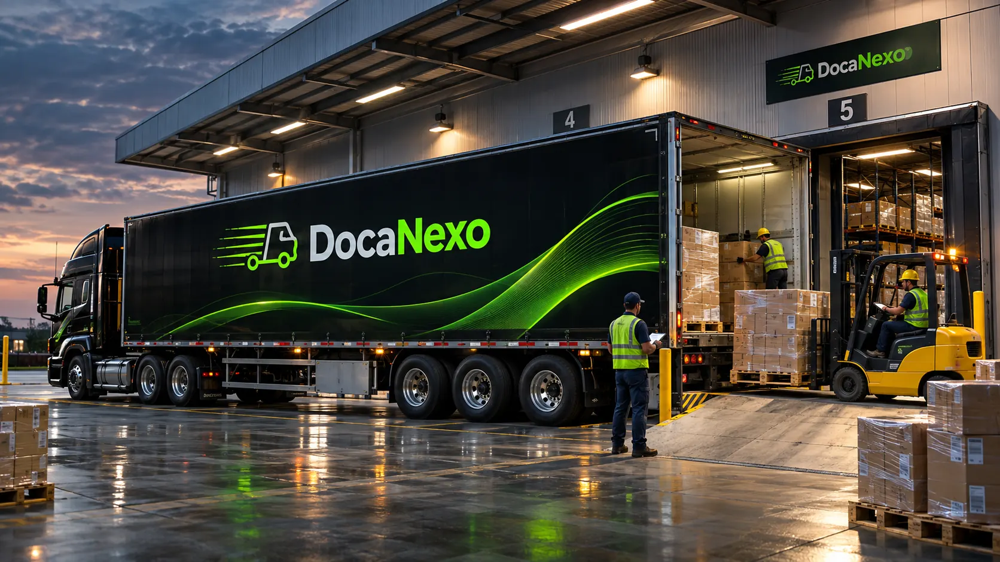

# DocaNexo

Projeto da Global Solution 2026/2 da FIAP, no tema CitizenTech.

Quando vários caminhões chegam ao mesmo tempo a um centro de distribuição, a falta de docas livres pode gerar filas, atrasos e mais trânsito e ruído nas ruas próximas. O DocaNexo permite consultar horários, reservar uma doca e comparar cenários de impacto na vizinhança.

## Imagem do projeto

## Tecnologias

- **HTML5** para estruturar as sete páginas e os formulários.
- **CSS3** para a identidade visual, o layout responsivo e as transições.
- **JavaScript** para o menu, as reservas, o simulador e a validação do contato.
- **localStorage** para guardar as reservas de demonstração no navegador.

## Estrutura de pastas

| Caminho | Conteúdo |
| --- | --- |
| Raiz do projeto | As sete páginas HTML e este README. |
| `css/` | Estilos compartilhados e transições entre páginas. |
| `js/` | Scripts da introdução, da navegação, dos agendamentos, da disponibilidade de docas, do simulador e da validação do contato. |
| `assets/` | Imagens da carreta e fotos dos integrantes. |

## Páginas

| Página | Função |
| --- | --- |
| [Início](index.html) | Apresenta a solução e demonstra como funciona o agendamento. |
| [Agendamentos](agendamentos.html) | Consulta horários, registra reservas, bloqueia conflitos na mesma doca e permite cancelamentos. |
| [Impacto urbano](impacto.html) | Calcula o Índice de Impacto de Vizinhança e compara até quatro cenários. |
| [Sobre](sobre.html) | Explica o problema, o objetivo e os limites do protótipo. |
| [Integrantes](integrantes.html) | Reúne as fotos e os perfis da equipe. |
| [FAQ](faq.html) | Responde a dúvidas sobre a solução. |
| [Contato](contato.html) | Demonstra a validação de um formulário de contato. |

## Funcionamento

Os agendamentos são armazenados no navegador. A Central de Operações começa com três reservas de exemplo e permite repor esses dados. O índice de impacto é ilustrativo, e a comparação de cenários dura enquanto a página está aberta. O formulário de contato simula o envio.

## Integrantes

| Nome completo | RM | Turma | GitHub | LinkedIn |
| --- | --- | --- | --- | --- |
| Erik Vasconcelos Da Silva | 575396 | 1TDSPT | [Xcodebyerik](https://github.com/Xcodebyerik) | [Erik Vasconcelos Da Silva](https://www.linkedin.com/in/erik-vasconcelos-9bb074365/) |
| Felipe Augusto Araújo Ramos da Silva | 575657 | 1TDSPT | [Felipeaards](https://github.com/Felipeaards) | [Felipe Augusto Araújo Ramos da Silva](https://www.linkedin.com/in/felipe-augusto-ara%C3%BAjo-ramos-da-silva-bb7223278/) |
| Henrique dos Santos Ramalho | 575759 | 1TDSPA | [henriqueramalho299](https://github.com/henriqueramalho299) | [Henrique dos Santos Ramalho](https://www.linkedin.com/in/henrique-ramalho-aa54752b0/) |

## Repositório

[DocaNexo Front-End no GitHub](https://github.com/henriqueramalho299/DocaNexo-FrontEnd)

## Contato

Contato da equipe pelo LinkedIn de [Henrique dos Santos Ramalho no LinkedIn](https://www.linkedin.com/in/henrique-ramalho-aa54752b0/).
